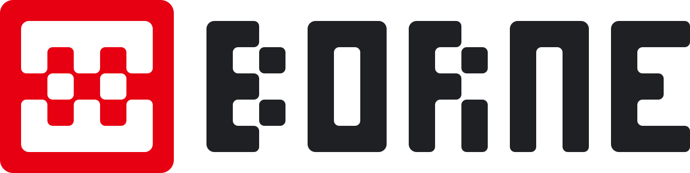

<h1>
  <picture>
    <source media="(prefers-color-scheme: dark)" srcset="docs/assets/logo-dark.svg">
    
  </picture>
</h1>

A couch-friendly, controller-driven launcher for your [RomM](https://github.com/rommapp/romm) game
library, on Linux (ChimeraOS, SteamOS or any desktop) and macOS. Pick a game with the gamepad, and
Borne downloads it (or plays it straight from the network), installs and configures the right
emulator, keeps each player's saves on RomM, and gets out of the way.

[](https://github.com/Lightmaster00/borne/actions/workflows/ci.yml)
[](https://lightmaster00.github.io/borne/)
[](https://github.com/Lightmaster00/borne/actions/workflows/release.yml)

## Install

Downloads are on the [releases page](https://github.com/Lightmaster00/borne/releases): the latest
stable release, or the `dev` pre-release rebuilt on every change.

**Linux** (x86_64)

```bash
tar xzf Borne-linux-x86_64.tar.gz
./Borne/install.sh            # installs to ~/.local/opt/Borne, adds a menu entry and ~/.local/bin/borne
```

`install.sh` also adds Borne to Steam as a non-Steam game, with its artwork: on ChimeraOS through
Chimera (it shows after the next Steam session start), elsewhere when Steam is closed (or later
from Settings → Help → Add to Steam). Emulators you already have are used — on the PATH, or
AppImages in `~/Applications` (EmuDeck's folder) — otherwise Borne installs its own in
`~/.local/share/borne/emulators`. `./install.sh --uninstall` removes the program; your games, saves and settings stay in
`~/.local/share/borne`. Playing from the network needs FUSE (`fusermount3`, present on ChimeraOS
and SteamOS).

**macOS** (Apple Silicon)

Unzip `Borne-macos-arm64.zip` and move `Borne.app` to Applications. The app is not notarized: the
first time, right-click it → **Open** (or run `xattr -dr com.apple.quarantine /Applications/Borne.app`).
Data lives in `~/Library/Application Support/borne`.

**First start**: type your RomM server's address (e.g. `http://192.168.1.20:8080`) with the
on-screen keyboard, create a profile, then approve the pairing from RomM (QR code or the code shown),
or sign in with the account's password.

## Updates

Borne updates itself: Settings → Updates checks GitHub at startup and every 6 hours, and installs
only when you confirm, never during a game. It downloads **only the parts that changed** — the
programs, the interface, or the Qt runtime — and checks each against its SHA-256: a usual update
weighs about 5 MB instead of the whole 70 MB package. The previous version is kept next to the new
one. Two channels: **Stable** (tagged releases) and **Development** (the `dev` pre-release).

## What it does

- **Profiles** ("Who's playing?"), each bound to a RomM account; pairing without a keyboard (code or
  QR code approved from the phone). Tokens are kept outside the database, readable only by you.
- **Your library, offline too**: *My library* holds the games ready to play here; the *Store* opens
  on your server's consoles as large cards, and A shows a console's games. Large covers at their own
  proportions, in the layout you choose: a grid scrolling down, one large row with the selected game
  above it, or two rows. Games come in groups the order explains (This week, A – F, the 1990s…);
  choose a console in the Consoles menu (cards fanned like a hand, ordered by play time, number of
  games, release date, name, maker or your own order), filter favourites, never played, two players
  or a genre, sort by last played, newest, name, play time or release date, search as you type, in
  titles from every region.
- **A border in your console's colours**: the screen is framed in the colour of the console of the
  game you are on, its logo large on top; a video of the selected game can play behind (off by
  default).
- **Game page**: a sheet with the cover, Play, favourite and the game's own settings (Y); the
  players' rating, your play time, the languages it really exists in, the summary, a table of facts
  (studios, series, release, modes, age rating, file, emulator, controller), the screenshots, and the
  trailer playing softly behind.
- **Each game its controller**: the version and the language, and the controller the console sees,
  per console or per game: a Switch Pro Controller, a pair of Joy-Con or the console in hand (the
  Pokémon Let's Go games get the Joy-Con by themselves); a Wii Remote with its Nunchuk, alone, held
  sideways or a Classic Controller; a Wii U GamePad or Pro Controller. A map shows what each of your
  buttons (Xbox, PlayStation or Nintendo) does in the game, and every button can be changed.
- **Downloads** with resume after interruption, SHA-1 checks, pause, cancel and a tidy list; or
  **play from the network**: on Linux only the games you pick are mounted, read from RomM on demand;
  on macOS they are downloaded as temporary copies, the least recently played removed first past
  the cache size.
  Games stored as zip or 7z on RomM are extracted (arcade sets stay zipped), and downloaded rather
  than played from the network.
- **Your consoles, your choice**: after the first sync Borne asks which consoles of the RomM library it
  shows (Settings → Consoles → Choose to change it later); the others stay on RomM, and Borne installs
  no emulator for them. Borne looks at the machine it runs on (touch screen, mouse, motion-sensor pad,
  Wii Remote, Bluetooth, threads and memory, Steam Deck) and says beside each console, on its settings
  page and on each game's page what its games need that this machine lacks: the 3DS and DS touch
  screen, the Wii Remote and its sensor bar, Joy-Con-only Switch games, the Wii U GamePad's screen,
  or a computer too weak for the heaviest consoles.
- **Emulators managed for you**: one per console, chosen in Settings → Emulators — RetroArch cores
  (Mesen, Snes9x, Genesis Plus GX, melonDS DS, SwanStation, Flycast, PPSSPP…), Dolphin, PCSX2, DuckStation,
  Azahar (3DS), Cemu (Wii U), Eden, Citron Neo and Ryubing (Switch), RPCS3 (PS3), shadPS4 (PS4), Xenia Canary
  (Xbox 360, Linux), Vita3K (PS Vita).
  Borne downloads each from its official source as soon as a console appears in your library,
  configures it (no first-run wizard, BIOS and keys put in place, fullscreen, the controller set for
  GameCube, Wii Remote and Nunchuk, PlayStation, Switch, 3DS…) and keeps it up to date; you never
  open it, and Borne sets each one's controller. A launch screen covers the passage to the
  emulator and back; Select + Start together pauses the game and asks whether to quit, and an
  emulator that cannot start the game is closed within a second, with the reason (read from its
  output and its own log).
- **Per-game settings**: another emulator for one game, its options (rewind, run-ahead, widescreen
  hacks, CPU overclock, Switch docked or handheld…), picture (shape, resolution, sharp, smooth or CRT
  pixels), controls for every emulator (which controller plays, A/B and X/Y swapped, what each
  button does), cheats, language, cover.
- **Saves on RomM**, per profile: fetched before a game when newer, sent after it, replaced copies
  archived — for RetroArch, memory cards per game (Dolphin, PCSX2, DuckStation), Switch, PS3, PS4,
  Xbox 360 save folders. Profiles never share saves.
- **Cheats** from public databases (libretro, matched by the game's title and region;
  DeadSkullzJr's DS codes, else libretro's; Dolphin's codes; switch-cheats-db), or a `.pnach` you
  give for a PS2 game.
- **System files** (BIOS, keys, firmware) taken from RomM or given by you, checked and placed for
  each emulator; Borne never downloads them by itself.
- **Settings in plain words**: installation and saves, the interface (videos, size, animations,
  clock, sounds, buttons shown), the picture in games, emulators, system files, game images, RomM,
  updates, help (diagnostics report without any password or token).
- **English and French**, following the system (`BORNE_LANG=fr|en` forces one).

Borne talks to nothing but your RomM server, ScreenScraper (game images) and GitHub (its own updates
and the emulators' releases).

## Controls

| Gamepad | Keyboard | Action |
|---|---|---|
| D-pad / left stick | Arrows | Move |
| A | Enter | Open / choose |
| B | Escape | Back (in the Store, back to its consoles) |
| X | X | Consoles (choose one, their order, quick filters, genre) |
| Y | T or Y | Sort and layout; on a game's page, its settings |
| Select | F2, Ctrl+F or / | Search (on the profile screen, Y: profile options) |
| — | Any letter or digit | Start a search with it |
| LB / RB | Page Up / Page Down, Q / E | My library / Store; in the Consoles menu, move the console chosen |
| LT / RT | R / C, Home / End | Previous / next group |
| R3 | Tab | Downloads |
| Start | M or F1 | Settings |
| Select + Start, together | Escape | Pause and ask whether to quit (any emulator) |

The hints on screen show the buttons of the device in use (or the one chosen in Settings →
Screen and sound). Borne is played with a gamepad or a keyboard only: the mouse is ignored.

## Documentation

- [`docs/SPEC.md`](docs/SPEC.md) — functional and technical specification.
- [`docs/DEVELOPMENT.md`](docs/DEVELOPMENT.md) — building, testing, translating, releasing.
- [`docs/ROADMAP.md`](docs/ROADMAP.md) — what is left to do and to check.

## License

GPL-3.0-or-later. The Borne name, logo and pictogram (`ui/brand`) identify this project. Qt is used under the LGPL (dynamic linking, replaceable libraries). Fonts:
Bricolage Grotesque and Manrope (SIL Open Font License, `ui/fonts/licenses`).
